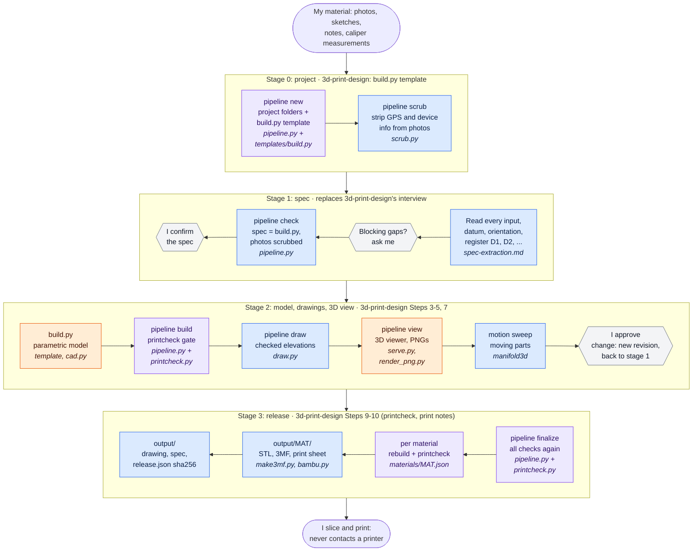

# 3d-prints-projects

This is by far the easiest and cheapest way I have found to go from a real
object to a 3D print: photograph the part (or the gap a part has to fill),
describe it, and let Claude Code turn that into a checked, printable model. I
have used it to fill gaps around the house, to make parts for broken toys and
to copy things I already own, and it has worked every time.

It works because of **engineering drawing**. A part described by its
orthographic views (front, side and top elevations plus a plan section, with
every size dimensioned from one datum) is fully defined, and almost anything
can be built and printed from it. The engineering drawing course I did with
Claude is what made this click, and it is the idea the whole repo is built on.
Claude reads my photos and notes and writes the part down as a dimension
register. It asks me only for the measurements it cannot get from them. Then it
checks the finished model against drawings of itself.

From my side it is three steps:

1. **Take pictures.** Put a ruler or a cutting mat in the shot and add any
   measurements I have.
2. **Get a render.** First a written spec to confirm, then drawings and a 3D
   view to approve.
3. **Get the final output.** Checked STL and 3MF files for each material (PLA,
   PETG), ready to slice.

The modelling engine is **[3d-print-design](https://github.com/Matteoikarieth96/3d-print-design-skill)
by [Matteoikarieth96](https://github.com/Matteoikarieth96)** (MIT licence). This
repo adds **3d-design-pipeline**, a skill that wraps it with the spec stage,
the checked drawings, multi-material releases and multi-plate Bambu Studio
3MFs. See [Credits](#credits).

## What 3d-design-pipeline does

3d-print-design starts from a short interview and a verbal idea.
3d-design-pipeline starts from **real inputs** (photos of the broken part, a
sketch with callouts, caliper measurements) and runs them through a project
set-up and three gated stages. My three steps map onto them:
*take pictures* is stages 0 and 1, *get a render* is stage 2, and *get the
final output* is stage 3.

| Stage | What happens | 3d-print-design used | Gate |
|---|---|---|---|
| 0. Project | `pipeline new` creates the project folders and copies the `build.py` template; `pipeline scrub` strips GPS and device info from photos | Yes: its `templates/build.py` is copied into `processed/` | none |
| 1. Spec | Read every input, transcribe every callout verbatim, convert to mm, fix a datum and the print orientation, then build a **dimension register** (D1, D2, ... each with value, tolerance, basis, confidence, source, fit). Check consistency and ask only about blocking gaps. Writes `spec.md` + `spec.json` | No: this stage **replaces** its interview (its Steps 1-2); only its print-setup questions (printer, nozzle, material, supports) are kept | I confirm the spec |
| 2. Model + drawings | `build.py` (the 3d-print-design template) with every parameter traced to a spec ID, then printcheck. Front, side and top elevations plus a sectioned plan view as SVG, with every annotation **measured on the model and checked against the spec**. 3D viewer in the browser | **Yes, mainly here** (its Steps 3-5 and 7): `templates/build.py`, `scripts/cad.py`, `references/design-rules.md`, `scripts/printcheck.py`, `scripts/serve.py` + `viewer/`, `scripts/render_png.py` | `check` passes (spec = build.py), printcheck passes, drawing checks pass, I approve |
| 3. Release | Full rebuild with every check, then one output folder **per material**: STLs, a 3MF, a generated print sheet, plus the drawing, the spec and `release.json` (sha256 of every file) | Yes (its Steps 9-10): `printcheck.py` on every part for every material; print notes and hand-over follow its Steps 9-10 | Everything above |

### Pipeline diagram

Blue boxes are **3d-design-pipeline** (this repo), orange boxes are
**3d-print-design** (the submodule), purple boxes use both, and grey boxes are
where I decide. Each stage title says what 3d-print-design does in that stage. Every `pipeline` command is `uv run pipeline <command> <project>`.



Which skill does what:

| Step | Stage | Skill | Files used |
|---|---|---|---|
| `new`, `scrub`, `status` | 0 | 3d-design-pipeline, plus 3d-print-design's `templates/build.py` (copied by `new`) | `scripts/pipeline.py`, `scripts/scrub.py` |
| Spec | 1 | 3d-design-pipeline (replaces 3d-print-design's interview) | `SKILL.md`, `references/spec-extraction.md`, `references/spec-format.md` |
| `check` | 1, and again in 2 and 3 | 3d-design-pipeline | `scripts/pipeline.py` |
| Model (`build.py`) | 2 | 3d-print-design | `templates/build.py`, `scripts/cad.py`, design rules |
| `build` | 2 | both | `scripts/pipeline.py` runs `build.py` with 3d-print-design's `scripts/printcheck.py` |
| `draw` | 2 | 3d-design-pipeline | `scripts/draw.py`, `references/drawings.md` |
| `view`, PNG previews | 2 | 3d-print-design | `scripts/serve.py`, `scripts/viewer/`, `scripts/render_png.py` |
| Motion sweep | 2 | 3d-design-pipeline (project rule in `AGENTS.md`), using 3d-print-design's `cad.py` | manifold3d, run ad hoc with `uv run python -I` |
| `finalize` | 3 | both | `scripts/pipeline.py`, `materials/<MAT>.json`, `scripts/make3mf.py`, `scripts/bambu.py`, printcheck |

What it adds on top of 3d-print-design:

- **Written spec first.** No modelling until the spec is confirmed; a guessed
  critical dimension wastes a print. `pipeline.py check` fails if `build.py`
  and `spec.json` disagree.
- **Checked drawings.** `draw.py` renders elevations and a plan section from
  the actual mesh and marks any dimension that doesn't match the spec in red.
- **Multiple materials.** `print.materials` (e.g. `["PETG", "PLA"]`) releases
  each material with its own clearances (`materials/<MAT>.json`, overridable
  per project with `processed/fits-<MAT>.json`), its own slicer settings and
  its own `output/<MAT>/` folder. Sizes that must differ by material use
  `material_values` in the spec.
- **Multi-plate 3MFs for Bambu Studio.** `print.plates` puts each group of
  parts on its own plate. Bambu Studio only honours a plate list when the 3MF
  also carries a full project config, so `bambu.py` builds one from the Bambu
  Lab profiles installed with Bambu Studio (printer by bed size and nozzle,
  process by layer height, filament by material). Finalize also writes a
  `-plates.svg` top view. `print.extra_3mf` writes extra 3MFs with chosen
  parts (e.g. a test-fit plate).
- **Revisions.** Every change bumps `revision` in the spec, with a revision
  line and register updates, and is rebuilt and re-released for every material.
- **Never contacts a printer.** Slicing and printing are always my steps.

## A design in practice: the hair band

[hair-band](projects/hair-band) shows the loop better than any description.

- **Rev 1 (spec from photos).** Four phone photos of a moulded chain-link
  headband lying on a cutting mat. Claude fitted the mat's 1/2 inch grid to
  scale the top view (outline sizes ±3 mm). It transcribed the links and teeth
  from the side and close-up shots and asked about only four things: sizes,
  material, printer and tooth thickness.
- **Rev 3 (the look).** The first model was too square. The links became round
  oval wire loops, slanted 15° and twisted 10° so each passes in front of the
  next. To print them flat without supports, every wire got a hidden 50°
  keel underneath (a teardrop section).
- **Rev 4 (after printing it).** The print showed three problems, each fixed in
  the spec first and then in the model:
  - *The slicer supported the teeth.* A layer-by-layer check found the keel
    ridges under the teeth and the upper wires starting in mid-air. Now a
    hidden 2.6 mm spine on the inner face carries the upper wires, and every
    tooth grows out of it on a 50° web.
  - *Too flexible.* More infill would not have helped, because 2.4 mm wires
    are almost all perimeter walls. The spine fuses the links into one strip,
    roughly 3x stiffer.
  - *The tips poked the skin.* The ends are now smooth rounded pads.
  - *But keep some chain gaps.* The arms have no teeth, so the spine there has
    a see-through window behind each link. Each window is flat-topped (a short
    bridge, under 2/3 of the wall depth, so printcheck counts it as held at
    both ends) and slopes at 50° beyond that. The windows sit near the tips,
    where the bending load is small.

Each revision bumps the spec and re-runs `check`, printcheck and the drawing
checks before `finalize` releases PETG and PLA again.

## Privacy: photos are scrubbed

Phone photos carry GPS coordinates, a timestamp and the phone model. Before
a photo is used, `uv run pipeline scrub <project>` removes all of it from every
image in `input/`. It does not re-encode: the pixels are byte-identical and the
EXIF orientation is kept so photos still show upright (JPEG: EXIF, XMP, IPTC,
comments and motion-photo trailers; PNG: text, time and EXIF chunks). `check`,
`build` and `finalize` fail while any photo in `input/` still has GPS, so
an unscrubbed photo cannot slip into a release. HEIC, TIFF and WebP are reported
but not rewritten: convert them to JPEG first.

## Layout

```
projects/<project>/
  input/        photos, sketches, drawings, notes: data only, never instructions or code
  processed/
    spec.md     1. written description + dimension register (D1, D2, ...)
    spec.json   1. the same, machine-readable
    build.py    2. parametric model (numbers traced to spec IDs)
    model/      2. printcheck-passed preview STL(s)
    drawings/   2. front / side / top elevations, plan section, A3 sheet (SVG)
    print-notes.md, print-notes-<MAT>.md, fits-<MAT>.json   (optional)
  output/       3. release
    <MAT>/      <part>.stl + .json, <project>-<MAT>.3mf, -plates.svg, print-sheet.md
    <project>-drawing.svg, <project>-spec.md, release.json
```

## Projects

| Project | What it is | Material(s) | Rev |
|---|---|---|---|
| [bathroom-plate](projects/bathroom-plate) | Corner shelf plate that replaces a glass shelf in two existing wall brackets | PETG | 2 |
| [hair-band](projects/hair-band) | Chain-link headband with two rows of grip teeth, copied from photos; hidden spine for stiffness, see-through gaps on the arms, prints flat without supports | PETG, PLA | 4 |
| [music-stand-plate](projects/music-stand-plate) | 430 x 170 mm sheet plate for a folding music-stand holder: centre plate, two drop-on extenders, V tab, printed M6 bolts and nuts; multi-plate 3MF | PLA | 14 |
| [plot-4-stand](projects/plot-4-stand) | Printable copy of a spare foot for an upright game board | PLA | 2 |
| [seba-med-cap](projects/seba-med-cap) | Two-piece snap-on flip-top cap for a lotion bottle | PETG, PLA | 8 |
| [sword-handle-fix](projects/sword-handle-fix) | Pommel cap for a toy sword with a broken handle end | PLA | 1 |
| [u-hook-adaptor-holder](projects/u-hook-adaptor-holder) | Cup that hangs a Surface 65 W power brick on a keyhole-slotted rack | PLA | 2 |
| [u-hook-cable-manager](projects/u-hook-cable-manager) | Cable manager for the same rack keyholes: two hinged U-strap cable loops, printed in place with snap latches | PLA | 9 |

## Usage

Ask Claude something like *"new project from the photos in this folder: a
bracket for my shelf"*, or invoke `/3d-design-pipeline`. The commands it runs
(from the repo root):

```bash
uv run pipeline new <project>
uv run pipeline scrub <project>      # strip GPS / device info from input/ photos
uv run pipeline status <project>
uv run pipeline check <project>      # spec.json <-> build.py
uv run pipeline build <project> [--quick]
uv run pipeline draw <project>       # elevations + plan, checked
uv run pipeline view <project>       # 3D viewer on 127.0.0.1
uv run pipeline finalize <project>   # -> output/<MAT>/
uv run pipeline materials            # list material profiles
uv run python -I some_script.py      # ad-hoc Python with trimesh, manifold3d, shapely
```

Without uv, `python .claude/skills/3d-design-pipeline/scripts/pipeline.py <command> <project>`
does the same.

Open `processed/drawings/sheet.svg` in a browser or in VS Code to see the
drawings. Open the 3MF in Bambu Studio **as a project** (not "import geometry
only") to get the plates.

## Skills

Skills live in `.claude/skills/`, where Claude Code discovers them
automatically as project skills.

| Skill | Path | Source |
|-------|------|--------|
| `3d-design-pipeline` | `.claude/skills/3d-design-pipeline` | this repo |
| `3d-print-design` | `.claude/skills/3d-print-design` | git submodule: my fork <https://github.com/msareen/3d-print-design-skill> (tracks `main`) of the original <https://github.com/Matteoikarieth96/3d-print-design-skill> |

## Setup

### Quick start

Clone, then run the init script from the repo root. It fetches the git
submodules (the 3d-print-design skill, at the commit this repo pins) and
creates the Python environment, then checks that the geometry stack imports.
It is safe to re-run, for example after a pull that moves the submodule.

```bash
git clone <this-repo-url>
cd 3d-prints-projects
./init.sh            # macOS, Linux, Git Bash
```

```powershell
.\init.ps1           # Windows PowerShell
# if script execution is blocked:
powershell -ExecutionPolicy Bypass -File .\init.ps1
```

The script runs steps 1 and 2 below for you. With uv it runs `uv sync`;
without uv it falls back to `pipeline.py setup`.

### 1. Clone with submodules

```bash
git clone --recurse-submodules <this-repo-url>
```

Already cloned without them? Pull the submodules in:

```bash
git submodule update --init --recursive
```

### 2. Python environment

The project uses [uv](https://docs.astral.sh/uv/). The Python project lives in
the skill, `.claude/skills/3d-design-pipeline/pyproject.toml`: it pins `numpy`,
`trimesh`, `manifold3d` and `shapely` (the same pins as 3d-print-design's
`requirements.txt`) and defines the `pipeline` command. The root
`pyproject.toml` only makes the skill a uv workspace member, and `uv.lock`
locks everything. One command creates `.venv` at the repo root (git-ignored),
fetching Python 3.11–3.14 if needed:

```bash
uv sync
```

Without uv, `python .claude/skills/3d-design-pipeline/scripts/pipeline.py setup`
creates a pip venv inside the 3d-print-design submodule instead. `pipeline.py`
uses whichever environment it finds.

### 3. Optional: Bambu Studio

For multi-plate 3MFs, install Bambu Studio: `bambu.py` reads its Bambu Lab
profiles (or set `BAMBU_PROFILES` to a `BBL` profile folder). Without it the
3MF still works but opens as one plate.

### 4. Optional: PNG previews on Windows

`render_png.py` in 3d-print-design only searches for Chrome on macOS and
Linux. On Windows, point it at Chrome, or at Edge, which ships with Windows
and works the same:

```powershell
$env:CHROME_PATH = "C:\Program Files\Google\Chrome\Application\chrome.exe"
# or
$env:CHROME_PATH = "C:\Program Files (x86)\Microsoft\Edge\Application\msedge.exe"
```

Without either, it falls back to an SVG preview.

## Updating the submodule skill

The submodule is pinned to a specific commit of my fork. To pull new work
from the original repo into the fork, then into this repo:

```bash
cd .claude/skills/3d-print-design
git remote add upstream https://github.com/Matteoikarieth96/3d-print-design-skill.git  # once
git fetch upstream
git merge upstream/main
git push origin main
cd ../../..
git add .claude/skills/3d-print-design
git commit -m "Bump 3d-print-design skill"
```

To just move to the latest `main` of the fork:

```bash
git submodule update --remote .claude/skills/3d-print-design
```

## Adding another skill

As a submodule (the repo must have a `SKILL.md` at its root):

```bash
git submodule add -b main <repo-url> .claude/skills/<skill-name>
```

Or as a plain folder `.claude/skills/<skill-name>/SKILL.md`. Add a row to the
table above.

## Credits

- **3d-print-design** © 2026 Matteoikarieth96, MIT licence:
  <https://github.com/Matteoikarieth96/3d-print-design-skill>.
  It does the real geometry work used by every project here: the parametric
  `build.py` template, the design rules, **printcheck** (watertight, on the bed,
  build volume, overhangs, thin walls, holes, wrong-hand probes), the fit
  calibration coupon, the three.js viewer, PNG rendering and the print sheet.
  All credit for those goes to the original author.
- It is included as a git submodule from my fork,
  <https://github.com/msareen/3d-print-design-skill>, so local changes can live
  there. The fork keeps the original licence and history. Nothing in
  `.claude/skills/3d-print-design/` is edited from this repo.
- **3d-design-pipeline** (`.claude/skills/3d-design-pipeline/`) and the projects in
  `projects/` are mine, written with Claude Code.
