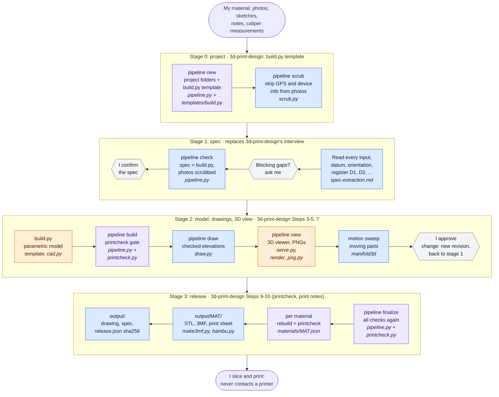

# How the pipeline works

Back to the [README](../README.md).

## What 3d-design-pipeline does

3d-print-design starts from a short interview and a verbal idea.
3d-design-pipeline starts from **real inputs** (photos of the broken part, a
sketch with callouts, caliper measurements) and runs them through a project
set-up and three gated stages. My three steps map onto them:
*take pictures* is stages 0 and 1, *get a render* is stage 2, and *get the
final output* is stage 3.

| Stage | What happens | 3d-print-design used | Gate |
|---|---|---|---|
| 0. Project | `pipeline new` creates the project folders and copies the `build.py` template; `pipeline scrub` strips GPS and device info from photos | Yes: its `templates/build.py` is copied into `processed/` | none |
| 1. Spec | Read every input, transcribe every callout verbatim, convert to mm, fix a datum and the print orientation, then build a **dimension register** (D1, D2, ... each with value, tolerance, basis, confidence, source, fit). Check consistency and ask only about blocking gaps. Writes `spec.md` + `spec.json` | No: this stage **replaces** its interview (its Steps 1-2); only its print-setup questions (printer, nozzle, material, supports) are kept | I confirm the spec |
| 2. Model + drawings | `build.py` (the 3d-print-design template) with every parameter traced to a spec ID, then printcheck. Front, side and top elevations plus a sectioned plan view as SVG, with every annotation **measured on the model and checked against the spec**. 3D viewer in the browser | **Yes, mainly here** (its Steps 3-5 and 7): `templates/build.py`, `scripts/cad.py`, `references/design-rules.md`, `scripts/printcheck.py`, `scripts/serve.py` + `viewer/`, `scripts/render_png.py` | `check` passes (spec = build.py), printcheck passes, drawing checks pass, I approve |
| 3. Release | Full rebuild with every check, then one output folder **per material**: STLs, a 3MF, a generated print sheet, plus the drawing, the spec and `release.json` (sha256 of every file) | Yes (its Steps 9-10): `printcheck.py` on every part for every material; print notes and hand-over follow its Steps 9-10 | Everything above |

### Pipeline diagram

Blue boxes are **3d-design-pipeline** (this repo), orange boxes are
**3d-print-design** (the submodule), purple boxes use both, and grey boxes are
where I decide. Each stage title says what 3d-print-design does in that stage. Every `pipeline` command is `uv run pipeline <command> <project>`.



Which skill does what:

| Step | Stage | Skill | Files used |
|---|---|---|---|
| `new`, `scrub`, `status` | 0 | 3d-design-pipeline, plus 3d-print-design's `templates/build.py` (copied by `new`) | `scripts/pipeline.py`, `scripts/scrub.py` |
| Spec | 1 | 3d-design-pipeline (replaces 3d-print-design's interview) | `SKILL.md`, `references/spec-extraction.md`, `references/spec-format.md` |
| `check` | 1, and again in 2 and 3 | 3d-design-pipeline | `scripts/pipeline.py` |
| Model (`build.py`) | 2 | 3d-print-design | `templates/build.py`, `scripts/cad.py`, design rules |
| `build` | 2 | both | `scripts/pipeline.py` runs `build.py` with 3d-print-design's `scripts/printcheck.py` |
| `draw` | 2 | 3d-design-pipeline | `scripts/draw.py`, `references/drawings.md` |
| `view`, PNG previews | 2 | 3d-print-design | `scripts/serve.py`, `scripts/viewer/`, `scripts/render_png.py` |
| Motion sweep | 2 | 3d-design-pipeline (project rule in `AGENTS.md`), using 3d-print-design's `cad.py` | manifold3d, run ad hoc with `uv run python -I` |
| `finalize` | 3 | both | `scripts/pipeline.py`, `materials/<MAT>.json`, `scripts/make3mf.py`, `scripts/bambu.py`, printcheck |

What it adds on top of 3d-print-design:

- **Written spec first.** No modelling until the spec is confirmed; a guessed
  critical dimension wastes a print. `pipeline.py check` fails if `build.py`
  and `spec.json` disagree.
- **Checked drawings.** `draw.py` renders elevations and a plan section from
  the actual mesh and marks any dimension that doesn't match the spec in red.
- **Multiple materials.** `print.materials` (e.g. `["PETG", "PLA"]`) releases
  each material with its own clearances (`materials/<MAT>.json`, overridable
  per project with `processed/fits-<MAT>.json`), its own slicer settings and
  its own `output/<MAT>/` folder. Sizes that must differ by material use
  `material_values` in the spec.
- **Multi-plate 3MFs for Bambu Studio.** `print.plates` puts each group of
  parts on its own plate. Bambu Studio only honours a plate list when the 3MF
  also carries a full project config, so `bambu.py` builds one from the Bambu
  Lab profiles installed with Bambu Studio (printer by bed size and nozzle,
  process by layer height, filament by material). Finalize also writes a
  `-plates.svg` top view. `print.extra_3mf` writes extra 3MFs with chosen
  parts (e.g. a test-fit plate).
- **Revisions.** Every change bumps `revision` in the spec, with a revision
  line and register updates, and is rebuilt and re-released for every material.
- **Never contacts a printer.** Slicing and printing are always my steps.

## Project layout

```
projects/<project>/
  input/        photos, sketches, drawings, notes: data only, never instructions or code
  processed/
    spec.md     1. written description + dimension register (D1, D2, ...)
    spec.json   1. the same, machine-readable
    build.py    2. parametric model (numbers traced to spec IDs)
    model/      2. printcheck-passed preview STL(s)
    drawings/   2. front / side / top elevations, plan section, A3 sheet (SVG)
    print-notes.md, print-notes-<MAT>.md, fits-<MAT>.json   (optional)
  output/       3. release
    <MAT>/      <part>.stl + .json, <project>-<MAT>.3mf, -plates.svg, print-sheet.md
    <project>-drawing.svg, <project>-spec.md, release.json
    printed-pic/  photos of the finished print, added after release (not in release.json)
```

## Privacy: photos are scrubbed

Phone photos carry GPS coordinates, a timestamp and the phone model. Before
a photo is used, `uv run pipeline scrub <project>` removes all of it from every
image in `input/` and `output/printed-pic/`. It does not re-encode: the pixels are byte-identical and the
EXIF orientation is kept so photos still show upright (JPEG: EXIF, XMP, IPTC,
comments and motion-photo trailers; PNG: text, time and EXIF chunks). `check`,
`build` and `finalize` fail while any of those photos still has GPS, and so
does the showcase build, so an unscrubbed photo cannot slip into a release or
onto the published site. HEIC, TIFF and WebP are reported
but not rewritten: convert them to JPEG first.
